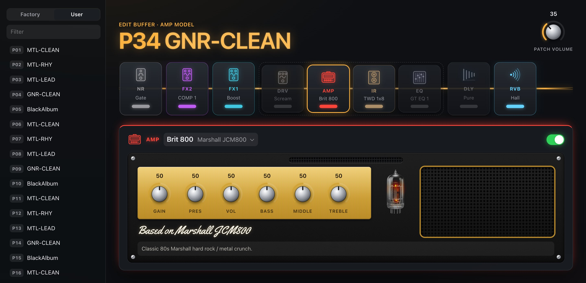
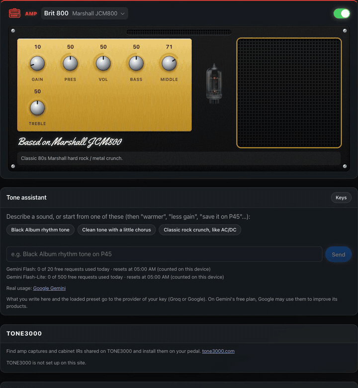
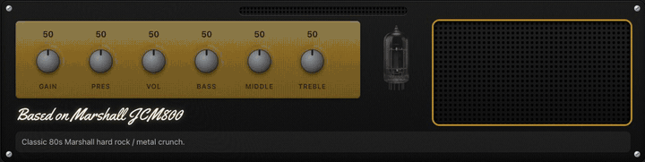
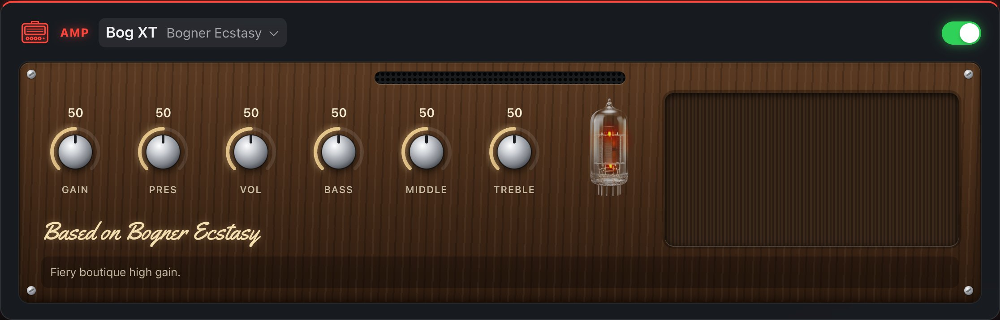

# OpenSonicX

**English** · [Português](README.pt-BR.md)

Free, open-source editor for Sonicake guitar pedals, in the browser, as a desktop app, and as an
MCP server so an AI assistant builds the tone you describe on the pedal.

- **Sonicake Pocket Master**: full editor over USB MIDI or Bluetooth.
- **Sonicake Matribox II Pro** (experimental): presets, chain, models and parameters, live edits
  and save ([docs/matribox.md](docs/matribox.md)).

No driver and no Connect button: open the page in Chrome, Edge or Opera and plug the pedal in;
the editor recognises which pedal it is and loads its presets.

**Open it:** https://fgbona.github.io/OpenSonicX/ (updated
with every release) · **Download the app:** [latest release](https://github.com/fgbona/OpenSonicX/releases/latest)
for macOS, Windows and Linux ([details](#desktop-app)).



Unofficial: not affiliated with or endorsed by Sonicake. Product names are
trademarks of their owners, used only to describe the modeled gear.

> **Status: 1.0.** The Pocket Master editor is stable: reading, live editing and saving are
> checked on a real pedal, on a computer and on an Android tablet (USB and Bluetooth). Every save
> backs up the slot it overwrites, unless you opt out for that save. The Matribox II Pro is
> **experimental**: every write is checked on one unit so far.

## Describe a tone, get it on the pedal

Type what you want to hear, "Black Album rhythm tone" or "warmer, less gain", and the tone
assistant picks the models and sets the knobs, live, listing what changed. It runs on your
own free AI key (Groq or Google Gemini) or a paid one (OpenRouter, Claude, OpenAI, xAI
Grok, DeepSeek, Mistral, Cerebras), called straight from the editor; saving still goes through the
Save dialog you confirm.



## The amp you picked, on screen

The AMP block dresses like the gear its model is based on (materials and
colours only, no logos), and its power tube is lit while the block is on:
it warms up when you switch it on or change model, and glows hotter with more
gain.



| | |
|---|---|
|  |  |
|  |  |
|  |  |
|  |  |

Every menu shows the pedal's own name next to what it is, grouped by style:


## What it does today

- Finds the plugged-in pedal by itself, like the official app: on load (the browser asks for MIDI
  access the first time only), when it is plugged in later, and again after it is unplugged or
  power-cycled, without a reload. With both pedals plugged in, the Pocket Master is opened first;
  an open connection is kept until its pedal is unplugged, then the other one is opened.
  Bluetooth (Pocket Master) has its own button: the browser needs that click.
- Reads the edit buffer and shows the signal chain with every parameter.
- Live edit (always on once connected): parameters, block on/off, model per block and
  chain order, sent to the pedal's edit buffer as you move the controls.
  Nothing is saved to a slot.
- Undo and redo (⌘Z / Ctrl+Z, ⇧⌘Z / Ctrl+Y) step through your edits; Revert reloads the
  preset from its slot, like switching presets on the pedal, so knob turns made on the unit
  are undone too.
- Saves to a user slot (P01..P50), backing up the slot it overwrites
  first (you can skip that per save). Copies a stored preset over another slot.
- Backups: back up one preset or all 50 to a file, restore one or all of them, download,
  import and delete backups, from the Backups panel. Slots are read without loading them.
- Exports and imports presets as files: our `.json` files and the `.prst` files Sonicake's own
  app exports. Before loading, it lists what changes against the loaded preset. Presets you
  like can be kept in a library in the browser or app.
- Turns the pedal's tuner on and off.
- Lists all 100 presets with a filter and loads one, asking first when the
  current one has unsaved changes.
- Loads a NAM capture (`.nam`) into a captured-profile slot, converting it
  in the browser, and a WAV into a user IR slot; renames and deletes them.
- Searches [TONE3000](https://www.tone3000.com) and installs a capture or IR
  on the pedal in one go (sign in with a code you approve on the site). The
  site needs a TONE3000 publishable key at build time:
  `NEXT_PUBLIC_TONE3000_CLIENT_ID` (in `apps/web/.env.local` for
  `npm run dev`; the `TONE3000_CLIENT_ID` repository variable for the
  release image).
- A tone assistant: describe a sound ("Black Album rhythm tone", "warmer, less gain", "save
  it on P45") and it builds it on the pedal, live, listing what changed. It runs on your own
  free AI key, Groq (about 1,000 requests a day) or Google Gemini, or both with automatic
  switching when one runs out; or a paid key (OpenRouter, Claude, OpenAI, xAI Grok, DeepSeek,
  Mistral, Cerebras), in the order you choose, with the cost of each answer. Called straight
  from the editor (no server of ours); keys stay on your device, or only for the session if
  you prefer. Saving still goes through the Save dialog you confirm. The panel walks you
  through creating free keys that can never charge you, and counts the free requests left
  today.
- Comments on captured-profile and IR slots (kept in this browser or app),
  shown next to their names in the menus.
- *Global options* (gear button): input and USB/Bluetooth levels, boot
  protection, backlight.
- A SysEx log (hidden by default; *Show the SysEx log* at the bottom of the page)
  with every message sent and received, in hex, with a label.
- **Matribox II Pro (experimental):** the editor recognises it by its MIDI port and shows its own
  editor: the 240 presets (1A..60D) with a filter, the loaded preset's chain with each model and
  the gear it is based on, live on/off, parameters (within each model's range) and models, add,
  move and remove blocks, and Save to a slot with an explicit confirmation and a backup of the
  slot first (kept in the browser, downloadable). Model names and parameters come from the
  catalog of Sonicake's official Matribox II PRO app, which is not ours to ship: in the browser
  you pick its `alg_data.json` once (on a Mac:
  `/Applications/Matribox II PRO.app/Contents/Frameworks/App.framework/Resources/flutter_assets/assets/alg/alg_data.json`)
  and it stays in that browser; the desktop app reads it from the installed app (or
  `MATRIBOX_CATALOG`). Without it the presets and chains still show, by module number.
  Undo and Redo cover every live edit there. The **tone assistant** works on the Matribox too,
  with the same free keys: it picks models by the real gear they are based on (from your catalog,
  which it needs), builds the whole chain or adjusts it, shows what changed, and saving still
  goes through the Save dialog for you to confirm.

## What works where

- **Pedal firmware:** tested on **V1.3.3**. The editor reads the version from the pedal
  (shown in *Global options*) and warns when it is another one, which may behave differently.
- **Browsers:** Chrome, Edge and Opera on a computer, over USB. Bluetooth in Chrome and Edge,
  checked in desktop Chrome and in Chrome on an Android tablet (USB and Bluetooth).
- **Not supported:** Safari and every browser on iPhone and iPad (no Web MIDI there); Firefox is untested.
  The desktop app covers macOS, Windows and Linux without a browser.
- **Pocket Master firmware limits:** a tempo (BPM) per preset, Sync and Trail on delays and modulation,
  and per-preset footswitch assignments. The unit ignores those writes, so the editor does not
  offer them (on this firmware a footswitch toggles a block through the pedal's own
  Function 1/2 setting).

## Install it as an app

The web editor installs like an app and then opens without an internet connection, for example
on an Android tablet on the pedalboard. In Chrome on Android, open
https://fgbona.github.io/OpenSonicX/ and choose *menu (⋮) > Install app* (or *Add to Home
screen*); on a computer, the install icon at the right of the address bar. It opens in its own
window, USB and Bluetooth work as in the browser, and the editor files are kept on the device
after the first visit. TONE3000, the AI assistant and the first NAM conversion still need the
network, and your own data (backups, keys, settings) stays in the browser's storage as before.
When a new version is out the editor says so and reloads only when you choose *Reload*
(otherwise the next time you open it).

## Repository layout

| Path | What it is |
|---|---|
| `packages/core` | The SysEx protocol in TypeScript: framing, decoding, model catalog, the guarded link to the pedal and the save/backup flows. No browser or MIDI dependency, so the web app and the MCP server share it. |
| `apps/web` | The Next.js editor. Web MIDI runs in the visitor's browser. |
| `apps/mcp` | An MCP server: the same core over native USB MIDI, for AI assistants. |
| `apps/desktop` | The editor as a desktop app (Electron) for Linux, Windows and macOS: works offline, updates itself. |
| `docs/` | Design notes and plans. |

## Desktop app

Each [release](https://github.com/fgbona/OpenSonicX/releases/latest)
attaches installers:

| System | File |
|---|---|
| macOS, Apple Silicon (M1 and later) | `OpenSonicX-<version>-mac-arm64.dmg` |
| macOS, Intel | `OpenSonicX-<version>-mac-x64.dmg` |
| Windows | `OpenSonicX-<version>-win-x64.exe` |
| Linux | `OpenSonicX-<version>-linux-x86_64.AppImage` |

The app runs the same editor without a browser or an internet connection; only TONE3000 and the first NAM conversion
(which downloads a reference file once) need the network.

- **Renamed in 1.0.0** from *Pocket Master Editor* to *OpenSonicX*. Installed copies update in
  place and keep their data (backups, keys, settings); on macOS an updated copy keeps its old
  name in Applications.
- **The app updates itself** on every system: a new version downloads in the
  background and installs when you choose *Restart now* (or the next time you
  open the app).
- **macOS** builds are not notarized (no Apple Developer account). The first
  time, right-click the app and choose *Open* (or allow it in *System Settings >
  Privacy & Security*). Updates after that need nothing.
- Windows may show a SmartScreen warning for the unsigned installer: *More info >
  Run anyway*.

From the repository: `npm run start -w @pocket-master/desktop` builds and opens
it; `npm run dist -w @pocket-master/desktop` makes the installer for your
system in `apps/desktop/release`.

## Use it from an AI assistant (MCP)

> Pocket Master: reading, live edits, revert and saving with backup are checked on a pedal;
> restores and preset files are checked against a simulated pedal. Matribox II Pro: every write
> tool is checked on one unit (experimental), except the whole-preset import and restore.

`apps/mcp` lets an assistant such as Claude read and tweak your sound in
conversation ("more gain on the amp", "try the Randall profile", "save this
as P12"). It runs on your computer and talks to the pedal over USB, so the
pedal must be plugged into the machine running the assistant. macOS and
Linux (x64, arm64) are supported.

```sh
claude mcp add pocket-master -- npx -y sonicake-pocket-master-mcp
```

The package is [`sonicake-pocket-master-mcp`](https://www.npmjs.com/package/sonicake-pocket-master-mcp)
(unofficial). For other MCP clients, run `npx -y sonicake-pocket-master-mcp` as
a stdio server. From a clone of this repository, use
`node apps/mcp/src/server.ts` instead.
Close the web editor's connection first if both would talk to the pedal at
the same time.

Tools: `get_preset`, `list_presets`, `list_models`, `edit_preset`,
`select_preset`, `revert_preset`, `undo_edit`, `save_preset`, `restore_backup`,
`export_preset`, `list_preset_files`, `import_preset`, `load_ir`, `load_nam`,
`tone3000_login`, `search_tone3000`, `install_tone`, `rename_slot`, `delete_slot`,
`copy_preset`, `set_tuner`, `backup_all_presets`,
`get_global_settings`, `set_global_settings`.

- Blocks, parameters and models are named as on the pedal; user IRs and
  captured profiles go by the names of the files you loaded. The server
  knows the real gear behind each model (from the Pocket Master manual), so
  "build me the Black Album rhythm tone on P50 and save it" works without
  naming models. A name that is
  unknown or ambiguous fails with the valid choices, and nothing is sent.
- Edits only change the edit buffer. `save_preset` overwrites a user slot
  only with `confirm` repeating that slot (e.g. `"P12"`), and first backs the
  slot up to `~/.pocket-master-editor/backups`; `restore_backup` undoes it.
- `load_ir` writes a WAV impulse response from `~/.pocket-master-editor/irs`
  into a user IR slot. The pedal cannot send an IR back, so an occupied slot
  is only overwritten when you say so; keep the WAVs you load.
- [TONE3000](https://www.tone3000.com) captures go straight to the pedal:
  `tone3000_login` signs you in with a code you approve on the site,
  `search_tone3000` finds NAM amp captures or cabinet IRs (for gear the
  pedal has no model of), and `install_tone` downloads one, converts a NAM
  capture into the pedal's captured-profile format (about a minute or more)
  and writes it to a profile slot, or writes an IR to a user IR slot.
  `load_nam` does the same with a `.nam` in `~/.pocket-master-editor/nams`.
  You sign in with your own TONE3000 account; the package already carries
  the editor's app key. To use an app key of your own instead, put
  `TONE3000_CLIENT_ID=...` in `~/.pocket-master-editor/tone3000.env`. The conversion
  downloads a reference DI signal from SonicMaster's repository once (it is
  not part of this project) and checks it by SHA-256.
- `get_global_settings` and `set_global_settings` read and change the
  device-wide options (master volume, input/FX-rec/monitor/BT-rec levels,
  backlight, boot anti-touch protection). They affect every preset. Factory reset
  is only in the web editor, behind a typed confirmation.
- Tones you like can be kept: say "keep this tone" and the assistant exports
  it with notes (e.g. which record it matches). `list_preset_files` shows
  them, and asking for the same tone again loads it at once instead of
  rebuilding it.
- Building a tone takes about a minute, almost all of it the assistant's
  reasoning; the pedal side takes a fraction of a second per call (each call
  is logged in `~/.pocket-master-editor/timings.log`). For quicker answers,
  start the session with `claude --effort low`.
- Preset files use the same [format](docs/preset-file-format.md) as the web editor's Export/Import and
  live in `~/.pocket-master-editor/presets` (set `POCKET_MASTER_HOME` to
  move both folders). The server reads and writes files only inside these
  folders.
- `.prst` preset files exported by Sonicake's own app can be imported too, here and in the web editor's Import preset.
- **Matribox II Pro (experimental):** the same server reads and edits a Matribox II Pro.
  `which_pedal` says which pedal is plugged in. Reading: `matribox_get_preset`,
  `matribox_list_presets`, `matribox_list_models`, `matribox_list_irs`, `matribox_list_captures`.
  Editing the loaded preset live: `matribox_set_param`, `matribox_set_module_on`,
  `matribox_set_model`, `matribox_add_block`, `matribox_remove_block`, `matribox_move_block`,
  `matribox_select_preset`, and `matribox_build_tone`, which builds a whole chain in one call
  ("Appetite for Destruction rhythm tone"), picking models by the real gear they are based on.
  `matribox_save_preset` stores it with `confirm` repeating the slot label (e.g. `"58D"`) after a
  backup to `~/.pocket-master-editor/backups`. Whole presets: `matribox_export_preset` writes the
  loaded preset or a slot as a `.prst` (the format of Sonicake's own app) in
  `~/.pocket-master-editor/presets/matribox`, `matribox_import_preset` stores one in a slot
  you confirm, and `matribox_restore_backup` puts a backup back into its slot. Import and restore
  send the whole preset in one write, as the official app does (chain, parameters, knob,
  expression-pedal and footswitch assignments, volume and tempo), and the unit keeps it in that
  slot at once; the slot is backed up first. The official app's write is checked on the unit; ours
  (the same data, uncompressed) is still to be checked. The model list comes from Sonicake's official
  Matribox II PRO app, which must be installed (or set `MATRIBOX_CATALOG` to its `alg_data.json`).
  Loading your own IRs and captures into the Matribox is not available yet: the WAV conversion
  and the transport match the official editor byte for byte, one field of the IR message is still
  unknown. See [docs/matribox.md](docs/matribox.md).

## Protocol

The wire format follows [`docs/PROTOCOL.md`](https://github.com/voronkovd/pocket-master-mcp/blob/main/docs/PROTOCOL.md)
of pocket-master-mcp (MIT). The implementation here was written from scratch.
Real captures from a V1.3.3 unit live in `packages/core/test/fixtures` and are
the reference the tests check against.

## Releases

Each version is a git tag, a [GitHub release](https://github.com/fgbona/OpenSonicX/releases)
and a container image in the GitHub Container Registry. Changes are listed in
[CHANGELOG.md](CHANGELOG.md). From 1.0 the project follows semantic versioning: the MCP tool
contract and the preset file format only change in a major version; versions below 1.0 were
previews.

## Contributing

Contributions are welcome. Read [CONTRIBUTING.md](CONTRIBUTING.md) first; the
most useful thing you can send is a SysEx capture from your own unit.

## Credits and license

MIT, see [LICENSE](LICENSE). The model catalog comes from pocket-master-mcp,
which derived it from [PocketEdit](https://github.com/suckyble/PocketEdit);
see [NOTICE](NOTICE). Not affiliated with Sonicake.
