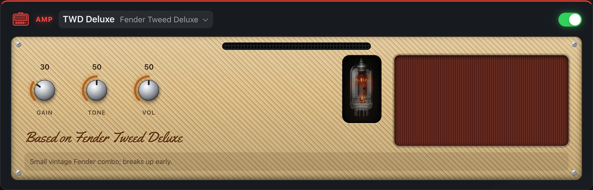
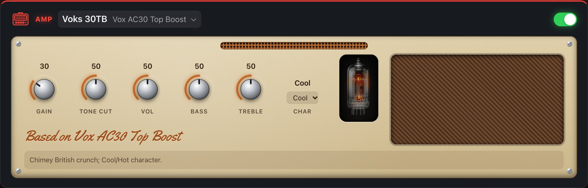
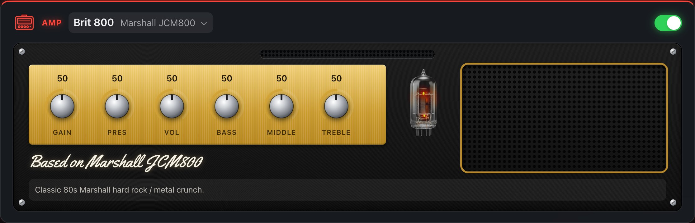
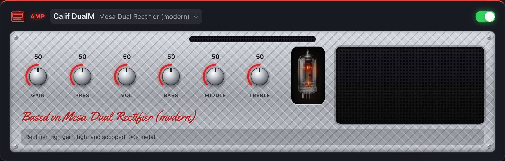
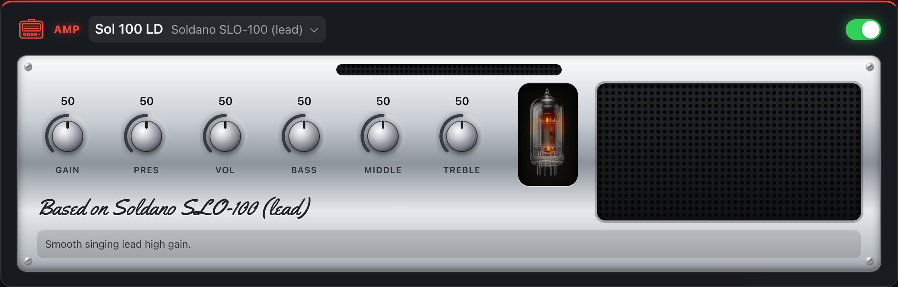
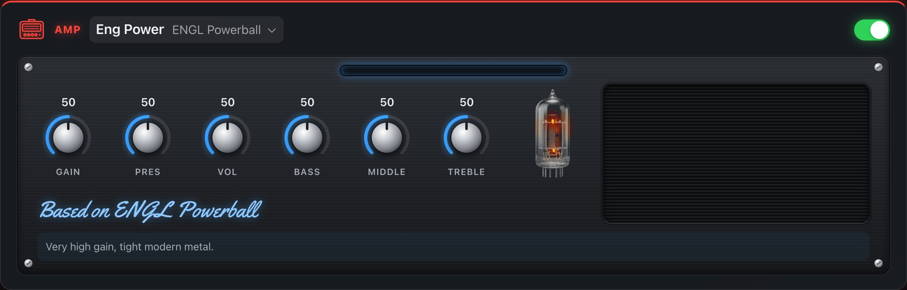
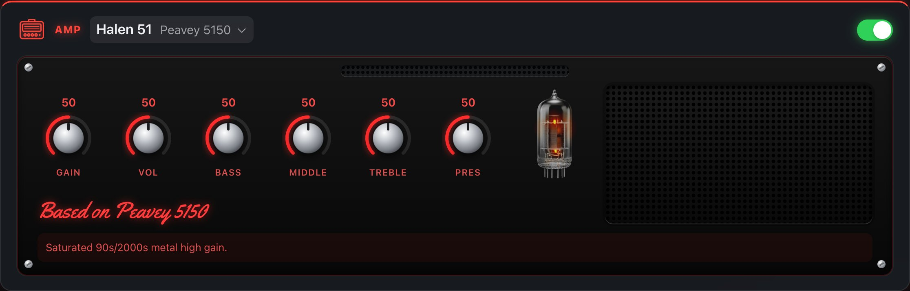
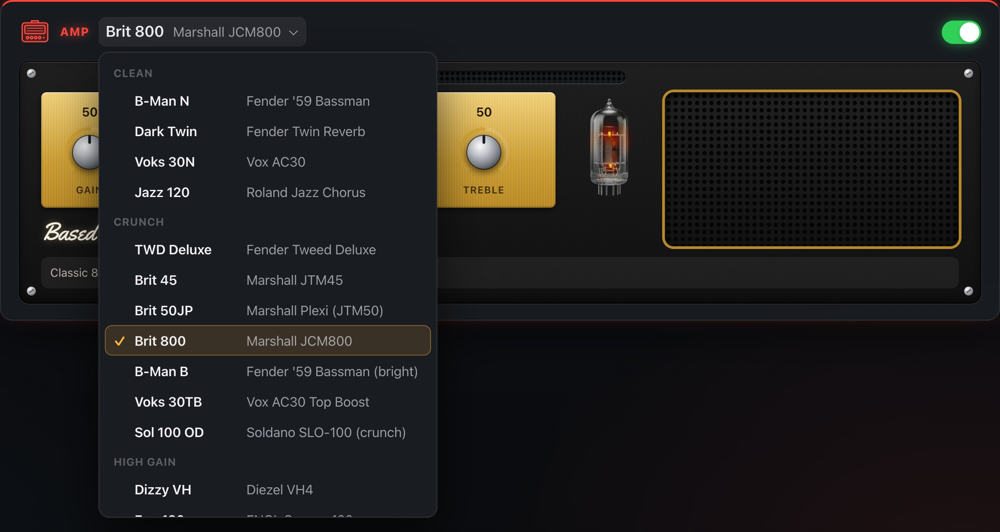

# Pocket Master Editor

A free, open-source editor for the **Sonicake Pocket Master** guitar
multi-effects pedal, over USB MIDI or Bluetooth. No driver: open the page in
Chrome, Edge or Opera, plug the pedal in, and read your preset.

**Open it:** https://fgbona.github.io/sonicake-pocket-master-editor/ (updated
with every release) · **Download the app:** [latest release](https://github.com/fgbona/sonicake-pocket-master-editor/releases/latest)
for macOS, Windows and Linux ([details](#desktop-app)).


Unofficial: not affiliated with or endorsed by Sonicake. Product names are
trademarks of their owners, used only to describe the modeled gear.

> **Status: preview.** Reading, live editing and saving to preset slots work.
> Every save backs up the slot it overwrites, unless you opt out for that save.

## The amp you picked, on screen

The AMP block dresses like the gear its model is based on (materials and
colours only, no logos), and its power tube is lit while the block is on:
it warms up when you switch it on or change model, and glows hotter with more
gain.


| | |
|---|---|
|  |  |
|  |  |
|  |  |
|  |  |

Every menu shows the pedal's own name next to what it is, grouped by style:



## What it does today

- Lists MIDI ports and connects to the Pocket Master.
- Reads the edit buffer and shows the signal chain with every parameter.
- Live edit (off by default): parameters, block on/off, model per block and
  chain order, sent to the pedal's edit buffer as you move the controls.
  Nothing is saved to a slot.
- Revert reloads the preset from its slot, like switching presets on the
  pedal, so knob turns made on the unit are undone too.
- Saves to a user slot (P01..P50), backing up the slot it overwrites
  first (you can skip that per save). Backups can be downloaded and
  restored from the Backups panel.
- Lists all 100 presets with a filter and loads one, asking first when the
  current one has unsaved changes.
- Loads a NAM capture (`.nam`) into a captured-profile slot, converting it
  in the browser, and a WAV into a user IR slot.
- Searches [TONE3000](https://www.tone3000.com) and installs a capture or IR
  on the pedal in one go (sign in with a code you approve on the site). The
  site needs a TONE3000 publishable key at build time:
  `NEXT_PUBLIC_TONE3000_CLIENT_ID` (in `apps/web/.env.local` for
  `npm run dev`; the `TONE3000_CLIENT_ID` repository variable for the
  release image).
- Comments on captured-profile and IR slots (kept in this browser or app),
  shown next to their names in the menus.
- *Global options* (gear button): input and USB/Bluetooth levels, boot
  protection, backlight.
- A SysEx log (hidden by default; *Show the SysEx log* at the bottom of the page)
  with every message sent and received, in hex, with a label.

## What works where

- **Pedal firmware:** tested on **V1.3.3**. Other versions may behave differently; the editor
  cannot read the firmware version from the pedal yet.
- **Browsers:** Chrome, Edge and Opera on a computer, over USB. Bluetooth in Chrome and Edge;
  tested in desktop Chrome, Android still to be confirmed on a real phone.
- **Not supported:** Safari and every browser on iPhone and iPad (no Web MIDI there); Firefox is untested.
  The desktop app covers macOS, Windows and Linux without a browser.
- **Not on this firmware:** a tempo (BPM) per preset, Sync and Trail on delays and modulation,
  and per-preset footswitch assignments. The unit ignores those writes, so the editor does not
  offer them (on this firmware a footswitch toggles a block through the pedal's own
  Function 1/2 setting).

## Repository layout

| Path | What it is |
|---|---|
| `packages/core` | The SysEx protocol in TypeScript: framing, decoding, model catalog, the guarded link to the pedal and the save/backup flows. No browser or MIDI dependency, so the web app and the MCP server share it. |
| `apps/web` | The Next.js editor. Web MIDI runs in the visitor's browser. |
| `apps/mcp` | An MCP server: the same core over native USB MIDI, for AI assistants. |
| `apps/desktop` | The editor as a desktop app (Electron) for Linux, Windows and macOS: works offline, updates itself. |
| `docs/` | Design notes and plans. |

## Desktop app

Each [release](https://github.com/fgbona/sonicake-pocket-master-editor/releases/latest)
attaches installers:

| System | File |
|---|---|
| macOS, Apple Silicon (M1 and later) | `Pocket-Master-Editor-<version>-mac-arm64.dmg` |
| macOS, Intel | `Pocket-Master-Editor-<version>-mac-x64.dmg` |
| Windows | `Pocket-Master-Editor-<version>-win-x64.exe` |
| Linux | `Pocket-Master-Editor-<version>-linux-x86_64.AppImage` |
 The app runs the same editor without a
browser or an internet connection; only TONE3000 and the first NAM conversion
(which downloads a reference file once) need the network.

- **The app updates itself** on every system: a new version downloads in the
  background and installs when you choose *Restart now* (or the next time you
  open the app).
- **macOS** builds are not notarized (no Apple Developer account). The first
  time, right-click the app and choose *Open* (or allow it in *System Settings >
  Privacy & Security*). Updates after that need nothing.
- Windows may show a SmartScreen warning for the unsigned installer: *More info >
  Run anyway*.

From the repository: `npm run start -w @pocket-master/desktop` builds and opens
it; `npm run dist -w @pocket-master/desktop` makes the installer for your
system in `apps/desktop/release`.

## Use it from an AI assistant (MCP)

> **Preview.** Reading, live edits, revert and saving with backup are checked
> on a pedal; restores and preset files are checked against a simulated pedal.

`apps/mcp` lets an assistant such as Claude read and tweak your sound in
conversation ("more gain on the amp", "try the Randall profile", "save this
as P12"). It runs on your computer and talks to the pedal over USB, so the
pedal must be plugged into the machine running the assistant. macOS and
Linux (x64, arm64) are supported.

```sh
claude mcp add pocket-master -- npx -y sonicake-pocket-master-mcp
```

The package is [`sonicake-pocket-master-mcp`](https://www.npmjs.com/package/sonicake-pocket-master-mcp)
(unofficial). For other MCP clients, run `npx -y sonicake-pocket-master-mcp` as
a stdio server. From a clone of this repository, use
`node apps/mcp/src/server.ts` instead.
Close the web editor's connection first if both would talk to the pedal at
the same time.

Tools: `get_preset`, `list_presets`, `list_models`, `edit_preset`,
`select_preset`, `revert_preset`, `undo_edit`, `save_preset`, `restore_backup`,
`export_preset`, `list_preset_files`, `import_preset`, `load_ir`, `load_nam`,
`tone3000_login`, `search_tone3000`, `install_tone`, `rename_slot`,
`get_global_settings`, `set_global_settings`.

- Blocks, parameters and models are named as on the pedal; user IRs and
  captured profiles go by the names of the files you loaded. The server
  knows the real gear behind each model (from the Pocket Master manual), so
  "build me the Black Album rhythm tone on P50 and save it" works without
  naming models. A name that is
  unknown or ambiguous fails with the valid choices, and nothing is sent.
- Edits only change the edit buffer. `save_preset` overwrites a user slot
  only with `confirm` repeating that slot (e.g. `"P12"`), and first backs the
  slot up to `~/.pocket-master-editor/backups`; `restore_backup` undoes it.
- `load_ir` writes a WAV impulse response from `~/.pocket-master-editor/irs`
  into a user IR slot. The pedal cannot send an IR back, so an occupied slot
  is only overwritten when you say so; keep the WAVs you load.
- [TONE3000](https://www.tone3000.com) captures go straight to the pedal:
  `tone3000_login` signs you in with a code you approve on the site,
  `search_tone3000` finds NAM amp captures or cabinet IRs (for gear the
  pedal has no model of), and `install_tone` downloads one, converts a NAM
  capture into the pedal's captured-profile format (about a minute or more)
  and writes it to a profile slot, or writes an IR to a user IR slot.
  `load_nam` does the same with a `.nam` in `~/.pocket-master-editor/nams`.
  You sign in with your own TONE3000 account; the package already carries
  the editor's app key. To use an app key of your own instead, put
  `TONE3000_CLIENT_ID=...` in `~/.pocket-master-editor/tone3000.env`. The conversion
  downloads a reference DI signal from SonicMaster's repository once (it is
  not part of this project) and checks it by SHA-256.
- `get_global_settings` and `set_global_settings` read and change the
  device-wide options (master volume, input/FX-rec/monitor/BT-rec levels,
  backlight, boot anti-touch protection). They affect every preset. Factory reset
  is only in the web editor, behind a typed confirmation.
- Tones you like can be kept: say "keep this tone" and the assistant exports
  it with notes (e.g. which record it matches). `list_preset_files` shows
  them, and asking for the same tone again loads it at once instead of
  rebuilding it.
- Building a tone takes about a minute, almost all of it the assistant's
  reasoning; the pedal side takes a fraction of a second per call (each call
  is logged in `~/.pocket-master-editor/timings.log`). For quicker answers,
  start the session with `claude --effort low`.
- Preset files use the same [format](docs/preset-file-format.md) as the web editor's Export/Import and
  live in `~/.pocket-master-editor/presets` (set `POCKET_MASTER_HOME` to
  move both folders). The server reads and writes files only inside these
  folders.

## Protocol

The wire format follows [`docs/PROTOCOL.md`](https://github.com/voronkovd/pocket-master-mcp/blob/main/docs/PROTOCOL.md)
of pocket-master-mcp (MIT). The implementation here was written from scratch.
Real captures from a V1.3.3 unit live in `packages/core/test/fixtures` and are
the reference the tests check against.

## Releases

Each version is a git tag, a [GitHub release](https://github.com/fgbona/sonicake-pocket-master-editor/releases)
and a container image in the GitHub Container Registry. Changes are listed in
[CHANGELOG.md](CHANGELOG.md). Versions below 1.0 are previews.

## Contributing

Contributions are welcome. Read [CONTRIBUTING.md](CONTRIBUTING.md) first; the
most useful thing you can send is a SysEx capture from your own unit.

## Credits and license

MIT, see [LICENSE](LICENSE). The model catalog comes from pocket-master-mcp,
which derived it from [PocketEdit](https://github.com/suckyble/PocketEdit);
see [NOTICE](NOTICE). Not affiliated with Sonicake.
