# OpenSonicX

[English](README.md) · **Português**

Editor livre e de código aberto para pedaleiras Sonicake: no navegador, como app desktop e como
servidor MCP, para um assistente de IA montar na pedaleira o timbre que você descrever.

- **Sonicake Pocket Master**: editor completo, por USB MIDI ou Bluetooth.
- **Sonicake Matribox II Pro** (experimental): presets, cadeia, modelos e parâmetros, edição ao
  vivo e salvar ([docs/matribox.md](docs/matribox.md), em inglês).

Sem driver e sem botão Conectar: abra a página no Chrome, Edge ou Opera e ligue a pedaleira; o
editor reconhece qual pedaleira é e carrega os presets dela.

**Abrir:** https://fgbona.github.io/OpenSonicX/ (atualizado a cada versão) · **Baixar o app:**
[última versão](https://github.com/fgbona/OpenSonicX/releases/latest) para macOS, Windows e Linux
([detalhes](#app-desktop)).

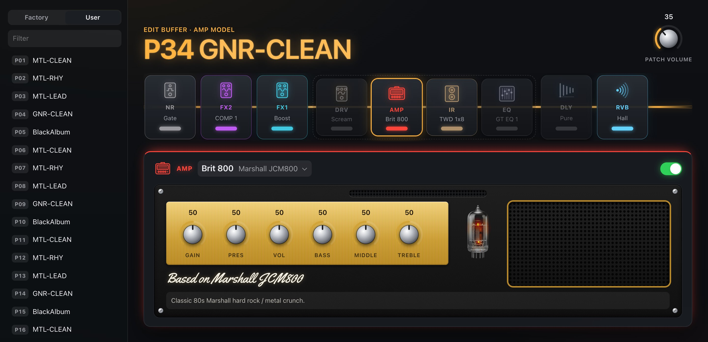

Não oficial: sem vínculo com a Sonicake nem endosso dela. Nomes de produtos são marcas dos seus
donos, usados só para descrever o equipamento modelado.

> **Status: 1.0.** O editor da Pocket Master é estável: leitura, edição ao vivo e salvar foram
> conferidos numa pedaleira real, no computador e num tablet Android (USB e Bluetooth). Todo
> salvamento faz backup do slot que vai sobrescrever, a menos que você dispense isso naquele
> salvamento. A Matribox II Pro é **experimental**: cada escrita foi conferida em uma unidade até
> agora.

## Descreva um timbre e ele vai para a pedaleira

Escreva o que quer ouvir, "timbre de base do Black Album" ou "mais quente, menos ganho", e o
assistente de timbre escolhe os modelos e ajusta os knobs, ao vivo, listando o que mudou. Ele usa
a sua própria chave de IA gratuita (Groq ou Google Gemini) ou uma paga (OpenRouter, Claude, OpenAI,
xAI Grok, DeepSeek, Mistral, Cerebras), chamada direto do editor; salvar continua passando pela
janela de Salvar que você confirma.

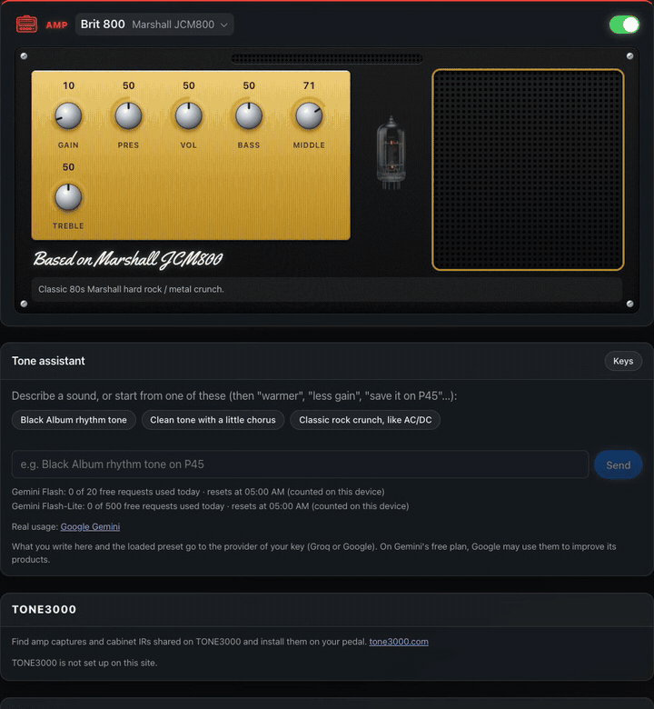

## O amplificador que você escolheu, na tela

O bloco AMP se veste como o equipamento em que o modelo se baseia (só materiais e cores, sem
logos), e a válvula de potência fica acesa enquanto o bloco está ligado: ela esquenta quando você
liga o bloco ou troca de modelo, e brilha mais com mais ganho.

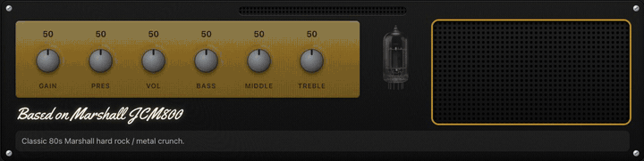

| | |
|---|---|
| 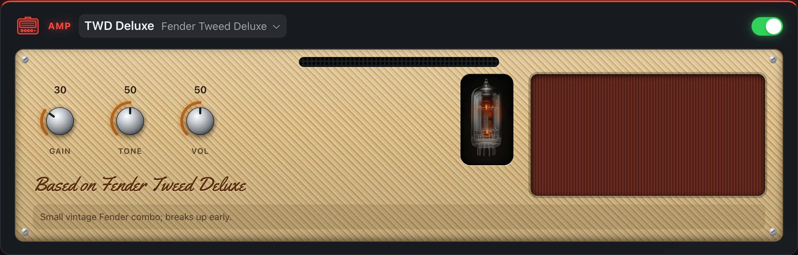 | 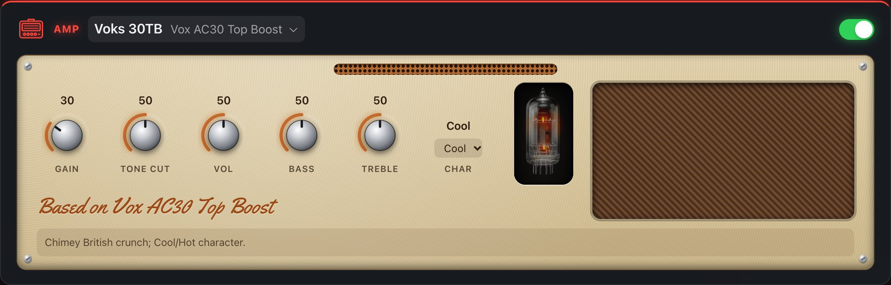 |
| 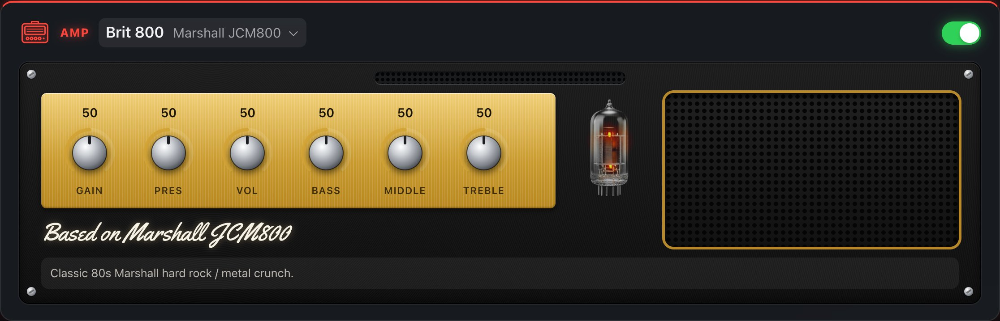 | 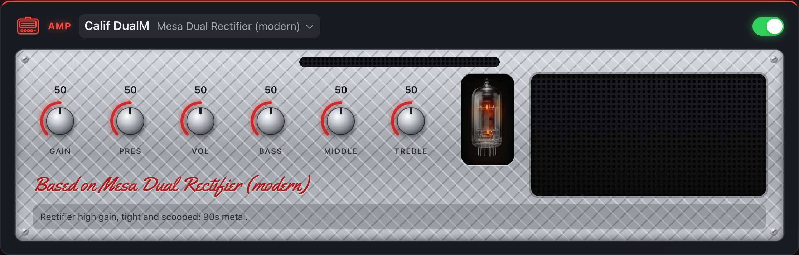 |
| 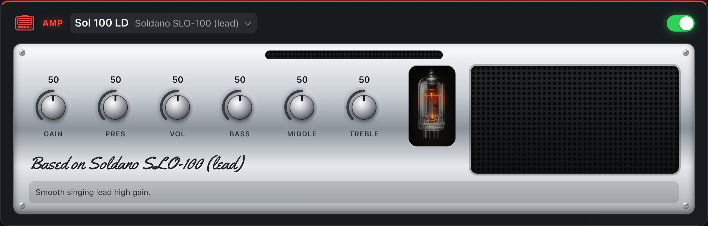 | 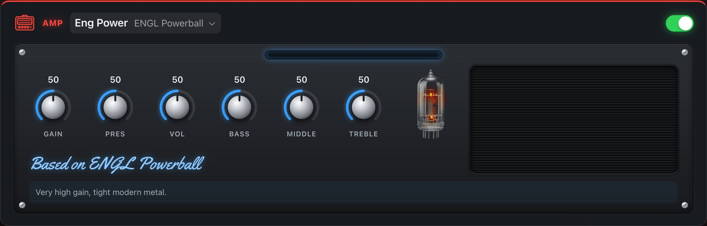 |
| 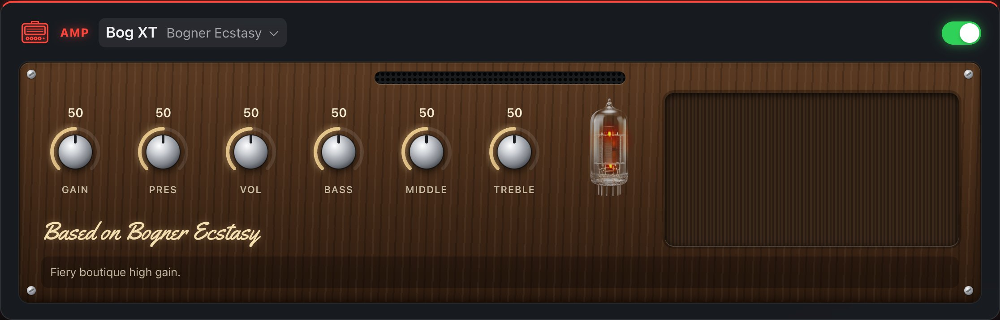 | 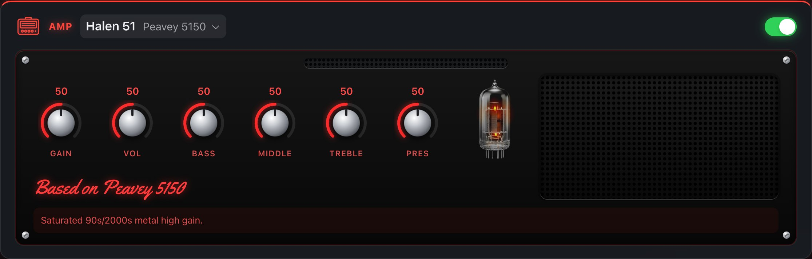 |

Todo menu mostra o nome que a pedaleira usa ao lado do que ele é, agrupado por estilo:

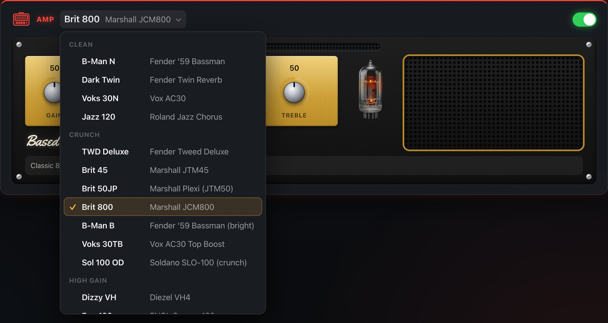

## O que ele faz hoje

- Encontra sozinho a pedaleira ligada, como o app oficial: ao abrir (o navegador pede acesso ao
  MIDI só na primeira vez), quando ela é ligada depois, e de novo depois de desligada ou de uma
  queda de energia, sem recarregar a página. Com as duas pedaleiras ligadas, a Pocket Master abre
  primeiro; a conexão aberta é mantida até a pedaleira dela ser desligada, e então a outra é
  aberta. O Bluetooth (Pocket Master) tem o próprio botão: o navegador exige esse clique.
- Lê o edit buffer e mostra a cadeia de sinal com todos os parâmetros.
- Edição ao vivo (sempre ligada depois de conectar): parâmetros, liga/desliga de bloco, modelo de
  cada bloco e ordem da cadeia, enviados ao edit buffer da pedaleira enquanto você mexe nos
  controles. Nada é salvo num slot.
- Desfazer e refazer (⌘Z / Ctrl+Z, ⇧⌘Z / Ctrl+Y) percorrem as suas edições; Reverter recarrega o
  preset do slot, como trocar de preset na pedaleira, então giros de knob feitos na própria
  unidade também são desfeitos.
- Salva num slot de usuário (P01..P50), fazendo antes o backup do slot que vai sobrescrever (dá
  para dispensar em cada salvamento). Copia um preset guardado para outro slot.
- Backups: faz backup de um preset ou dos 50 num arquivo, restaura um ou todos, baixa, importa e
  apaga backups, no painel Backups. Os slots são lidos sem carregá-los.
- Exporta e importa presets como arquivos: os nossos `.json` e os `.prst` que o próprio app da
  Sonicake exporta. Antes de carregar, lista o que muda em relação ao preset carregado. Os presets
  de que você gosta podem ficar numa biblioteca no navegador ou no app.
- Liga e desliga o afinador da pedaleira.
- Lista os 100 presets com filtro e carrega um, perguntando antes quando o atual tem alterações
  não salvas.
- Carrega uma captura NAM (`.nam`) num slot de perfil capturado, convertendo no navegador, e um
  WAV num slot de IR de usuário; renomeia e apaga esses slots.
- Busca no [TONE3000](https://www.tone3000.com) e instala uma captura ou IR na pedaleira de uma vez
  (o login é com um código que você aprova no site). O site precisa de uma chave publicável do
  TONE3000 na hora do build: `NEXT_PUBLIC_TONE3000_CLIENT_ID` (em `apps/web/.env.local` para
  `npm run dev`; a variável de repositório `TONE3000_CLIENT_ID` para a imagem de release).
- Um assistente de timbre: descreva um som ("timbre de base do Black Album", "mais quente, menos
  ganho", "salve no P45") e ele monta na pedaleira, ao vivo, listando o que mudou. Ele usa a sua
  própria chave de IA gratuita, Groq (cerca de 1.000 pedidos por dia) ou Google Gemini, ou as
  duas com troca automática quando uma acaba; ou uma chave paga (OpenRouter, Claude, OpenAI, xAI
  Grok, DeepSeek, Mistral, Cerebras), na ordem que você escolher, com o custo de cada resposta.
  Chamado direto do editor (nenhum servidor nosso); as chaves ficam no seu aparelho, ou só durante
  a sessão se preferir. Salvar continua passando pela janela de Salvar que você confirma. O painel
  ensina a criar chaves gratuitas que nunca geram cobrança e conta quantos pedidos gratuitos
  restam no dia.
- Comentários nos slots de perfil capturado e de IR (guardados neste navegador ou app), mostrados
  ao lado dos nomes nos menus.
- *Opções globais* (botão de engrenagem): níveis de entrada e de USB/Bluetooth, proteção na
  inicialização, luz de fundo.
- Um log de SysEx (escondido por padrão; *Mostrar o log de SysEx* no fim da página) com cada
  mensagem enviada e recebida, em hexadecimal, com uma descrição.
- **Matribox II Pro (experimental):** o editor a reconhece pela porta MIDI e mostra um editor
  próprio: os 240 presets (1A..60D) com filtro, a cadeia do preset carregado com cada modelo e o
  equipamento em que ele se baseia, liga/desliga ao vivo, parâmetros (dentro da faixa de cada
  modelo) e modelos, adicionar, mover e remover blocos, e Salvar num slot com confirmação
  explícita e backup do slot antes (guardado no navegador, para baixar). Os nomes dos modelos e os
  parâmetros vêm do catálogo do app oficial Matribox II PRO da Sonicake, que não é nosso para
  distribuir: no navegador você escolhe o `alg_data.json` dele uma vez (no Mac:
  `/Applications/Matribox II PRO.app/Contents/Frameworks/App.framework/Resources/flutter_assets/assets/alg/alg_data.json`)
  e ele fica naquele navegador; o app desktop lê do app instalado (ou de `MATRIBOX_CATALOG`). Sem
  ele, os presets e as cadeias aparecem mesmo assim, pelo número do módulo.
  Desfazer e refazer cobrem todas as edições ao vivo ali. O **assistente de timbre** também
  funciona na Matribox, com as mesmas chaves gratuitas: ele escolhe os modelos pelo equipamento
  real em que se baseiam (do seu catálogo, que ele precisa), monta a cadeia inteira ou ajusta, mostra
  o que mudou, e salvar continua passando pela janela de Salvar que você confirma.

## O que funciona onde

- **Firmware da pedaleira:** testado na **V1.3.3**. O editor lê a versão da pedaleira (aparece em
  *Opções globais*) e avisa quando é outra, que pode se comportar diferente.
- **Navegadores:** Chrome, Edge e Opera no computador, por USB. Bluetooth no Chrome e no Edge,
  conferido no Chrome do computador e no Chrome de um tablet Android (USB e Bluetooth).
- **Sem suporte:** Safari e todos os navegadores de iPhone e iPad (não têm Web MIDI); Firefox não
  foi testado. O app desktop cobre macOS, Windows e Linux sem navegador.
- **Limites do firmware da Pocket Master:** tempo (BPM) por preset, Sync e Trail em delays e
  modulações, e atribuições de footswitch por preset. A unidade ignora essas escritas, então o
  editor não as oferece (neste firmware um footswitch liga e desliga um bloco pela configuração
  Function 1/2 da própria pedaleira).

## Instalar como app

O editor web pode ser instalado como um app e depois abre sem internet, por exemplo num tablet
Android na pedaleira. No Chrome do Android, abra https://fgbona.github.io/OpenSonicX/ e escolha
*menu (⋮) > Instalar app* (ou *Adicionar à tela inicial*); no computador, o ícone de instalar à
direita da barra de endereço. Ele abre em janela própria, USB e Bluetooth funcionam como no
navegador, e os arquivos do editor ficam guardados no aparelho depois da primeira visita. O
TONE3000, o assistente de IA e a primeira conversão de NAM continuam precisando de rede, e os
seus dados (backups, chaves, configurações) ficam no armazenamento do navegador como antes.
Quando sai uma versão nova, o editor avisa e só recarrega quando você escolhe *Recarregar*
(senão, na próxima vez que abrir).

## Organização do repositório

| Caminho | O que é |
|---|---|
| `packages/core` | O protocolo SysEx em TypeScript: enquadramento, decodificação, catálogo de modelos, a conexão protegida com a pedaleira e os fluxos de salvar e backup. Sem dependência de navegador ou MIDI, então o app web e o servidor MCP o compartilham. |
| `apps/web` | O editor em Next.js. O Web MIDI roda no navegador de quem visita. |
| `apps/mcp` | Um servidor MCP: o mesmo core sobre USB MIDI nativo, para assistentes de IA. |
| `apps/desktop` | O editor como app desktop (Electron) para Linux, Windows e macOS: funciona offline e se atualiza sozinho. |
| `docs/` | Notas de design e planos (em inglês). |

## App desktop

Cada [versão](https://github.com/fgbona/OpenSonicX/releases/latest) traz instaladores:

| Sistema | Arquivo |
|---|---|
| macOS, Apple Silicon (M1 em diante) | `OpenSonicX-<versão>-mac-arm64.dmg` |
| macOS, Intel | `OpenSonicX-<versão>-mac-x64.dmg` |
| Windows | `OpenSonicX-<versão>-win-x64.exe` |
| Linux | `OpenSonicX-<versão>-linux-x86_64.AppImage` |

O app roda o mesmo editor sem navegador e sem internet; só o TONE3000 e a primeira conversão de
NAM (que baixa um arquivo de referência uma vez) precisam de rede.

- **Renomeado na 1.0.0** de *Pocket Master Editor* para *OpenSonicX*. As cópias instaladas se
  atualizam no lugar e mantêm os dados (backups, chaves, configurações); no macOS uma cópia
  atualizada mantém o nome antigo em Aplicativos.
- **O app se atualiza sozinho** em todos os sistemas: a versão nova é baixada em segundo plano e
  instalada quando você escolhe *Reiniciar agora* (ou na próxima vez que abrir o app).
- No **macOS** os builds não são notarizados (sem conta de desenvolvedor Apple). Na primeira vez,
  clique com o botão direito no app e escolha *Abrir* (ou permita em *Ajustes do Sistema >
  Privacidade e Segurança*). As atualizações seguintes não pedem nada.
- O Windows pode mostrar um aviso do SmartScreen para o instalador sem assinatura: *Mais
  informações > Executar assim mesmo*.

A partir do repositório: `npm run start -w @pocket-master/desktop` faz o build e abre o app;
`npm run dist -w @pocket-master/desktop` gera o instalador do seu sistema em
`apps/desktop/release`.

## Usar por um assistente de IA (MCP)

> Pocket Master: leitura, edição ao vivo, reverter e salvar com backup foram conferidos numa
> pedaleira; restaurar e arquivos de preset foram conferidos numa pedaleira simulada. Matribox II
> Pro: cada ferramenta de escrita foi conferida em uma unidade (experimental).

O `apps/mcp` deixa um assistente como o Claude ler e ajustar o seu som numa conversa ("mais ganho
no amp", "experimenta o perfil Randall", "salva isso no P12"). Ele roda no seu computador e fala
com a pedaleira por USB, então a pedaleira precisa estar ligada na máquina onde o assistente roda.
macOS e Linux (x64, arm64) são suportados.

```sh
claude mcp add pocket-master -- npx -y sonicake-pocket-master-mcp
```

O pacote é o [`sonicake-pocket-master-mcp`](https://www.npmjs.com/package/sonicake-pocket-master-mcp)
(não oficial). Para outros clientes MCP, rode `npx -y sonicake-pocket-master-mcp` como servidor
stdio. A partir de um clone deste repositório, use `node apps/mcp/src/server.ts`. Feche antes a
conexão do editor web se os dois forem falar com a pedaleira ao mesmo tempo.

Ferramentas: `get_preset`, `list_presets`, `list_models`, `edit_preset`, `select_preset`,
`revert_preset`, `undo_edit`, `save_preset`, `restore_backup`, `export_preset`,
`list_preset_files`, `import_preset`, `load_ir`, `load_nam`, `tone3000_login`, `search_tone3000`,
`install_tone`, `rename_slot`, `delete_slot`, `copy_preset`, `set_tuner`, `backup_all_presets`,
`get_global_settings`, `set_global_settings`.

- Blocos, parâmetros e modelos têm os nomes da pedaleira; IRs de usuário e perfis capturados têm
  os nomes dos arquivos que você carregou. O servidor conhece o equipamento real por trás de cada
  modelo (do manual da Pocket Master), então "monta o timbre de base do Black Album no P50 e
  salva" funciona sem citar modelos. Um nome desconhecido ou ambíguo falha mostrando as opções
  válidas, e nada é enviado.
- As edições só mudam o edit buffer. `save_preset` só sobrescreve um slot de usuário com
  `confirm` repetindo esse slot (ex.: `"P12"`), e antes faz backup do slot em
  `~/.pocket-master-editor/backups`; `restore_backup` desfaz.
- `load_ir` grava um impulse response WAV de `~/.pocket-master-editor/irs` num slot de IR de
  usuário. A pedaleira não devolve um IR, então um slot ocupado só é sobrescrito quando você
  pede; guarde os WAVs que carregar.
- Capturas do [TONE3000](https://www.tone3000.com) vão direto para a pedaleira: `tone3000_login`
  faz o login com um código que você aprova no site, `search_tone3000` encontra capturas NAM de
  amp ou IRs de gabinete (para equipamentos que a pedaleira não modela) e `install_tone` baixa
  uma, converte uma captura NAM para o formato de perfil capturado da pedaleira (cerca de um
  minuto ou mais) e grava num slot de perfil, ou grava um IR num slot de IR de usuário.
  `load_nam` faz o mesmo com um `.nam` em `~/.pocket-master-editor/nams`. O login é com a sua
  própria conta do TONE3000; o pacote já traz a chave de app do editor. Para usar uma chave de app
  sua, coloque `TONE3000_CLIENT_ID=...` em `~/.pocket-master-editor/tone3000.env`. A conversão
  baixa uma vez um sinal DI de referência do repositório do SonicMaster (não faz parte deste
  projeto) e confere pelo SHA-256.
- `get_global_settings` e `set_global_settings` leem e mudam as opções gerais do aparelho (volume
  master, níveis de input/FX-rec/monitor/BT-rec, luz de fundo, proteção anti-toque na
  inicialização). Elas afetam todos os presets. O reset de fábrica só existe no editor web, atrás
  de uma confirmação digitada.
- Timbres de que você gosta podem ser guardados: diga "guarda esse timbre" e o assistente exporta
  com notas (ex.: qual disco ele imita). `list_preset_files` mostra esses arquivos, e pedir o mesmo
  timbre de novo o carrega na hora em vez de montar outra vez.
- Montar um timbre leva cerca de um minuto, quase tudo raciocínio do assistente; o lado da
  pedaleira leva uma fração de segundo por chamada (cada chamada fica registrada em
  `~/.pocket-master-editor/timings.log`). Para respostas mais rápidas, inicie a sessão com
  `claude --effort low`.
- Os arquivos de preset usam o mesmo [formato](docs/preset-file-format.md) do Exportar/Importar
  do editor web e ficam em `~/.pocket-master-editor/presets` (defina `POCKET_MASTER_HOME` para
  mudar as duas pastas). O servidor só lê e grava arquivos dentro dessas pastas.
- Arquivos `.prst` exportados pelo próprio app da Sonicake também podem ser importados, aqui e no
  Importar preset do editor web.
- **Matribox II Pro (experimental):** o mesmo servidor lê e edita uma Matribox II Pro.
  `which_pedal` diz qual pedaleira está ligada. Leitura: `matribox_get_preset`,
  `matribox_list_presets`, `matribox_list_models`, `matribox_list_irs`, `matribox_list_captures`.
  Edição ao vivo do preset carregado: `matribox_set_param`, `matribox_set_module_on`,
  `matribox_set_model`, `matribox_add_block`, `matribox_remove_block`, `matribox_move_block`,
  `matribox_select_preset`, e `matribox_build_tone`, que monta uma cadeia inteira numa chamada
  ("timbre de base do Appetite for Destruction"), escolhendo os modelos pelo equipamento real em
  que se baseiam. `matribox_save_preset` grava com `confirm` repetindo o slot (ex.: `"58D"`) depois
  de um backup em `~/.pocket-master-editor/backups`. Presets inteiros: `matribox_export_preset`
  grava o preset carregado ou um slot como `.prst` (o formato do app da Sonicake) em
  `~/.pocket-master-editor/presets/matribox`, `matribox_import_preset` grava um num slot
  que você confirma, e `matribox_restore_backup` devolve um backup ao slot dele. Importar e
  restaurar mandam o preset inteiro numa escrita só, como o app oficial faz (cadeia, parâmetros,
  atribuições dos knobs, do pedal de expressão e dos footswitches, volume e andamento), e a
  pedaleira já guarda no slot; antes é feito o backup do slot. A escrita do app oficial foi
  conferida na pedaleira; a nossa (os mesmos dados, sem compressão) ainda falta conferir. A lista de modelos vem do app oficial Matribox
  II PRO da Sonicake, que precisa estar instalado (ou defina `MATRIBOX_CATALOG` com o caminho do
  `alg_data.json`). Carregar IRs e capturas suas na Matribox ainda não está disponível: a
  conversão do WAV e o envio já batem byte a byte com o editor oficial, falta decifrar um campo da
  mensagem de IR. Veja [docs/matribox.md](docs/matribox.md).

## Protocolo

O formato das mensagens segue o [`docs/PROTOCOL.md`](https://github.com/voronkovd/pocket-master-mcp/blob/main/docs/PROTOCOL.md)
do pocket-master-mcp (MIT). A implementação aqui foi escrita do zero. Capturas reais de uma
unidade V1.3.3 ficam em `packages/core/test/fixtures` e são a referência que os testes conferem.

## Versões

Cada versão é uma tag do git, uma [release no GitHub](https://github.com/fgbona/OpenSonicX/releases)
e uma imagem de contêiner no GitHub Container Registry. As mudanças ficam no
[CHANGELOG.md](CHANGELOG.md) (em inglês). A partir da 1.0 o projeto segue versionamento semântico:
o contrato das ferramentas MCP e o formato dos arquivos de preset só mudam numa versão major; as
versões abaixo da 1.0 eram prévias.

## Contribuir

Contribuições são bem-vindas. Leia antes o [CONTRIBUTING.md](CONTRIBUTING.md) (em inglês); o mais
útil que você pode mandar é uma captura de SysEx da sua própria unidade.

## Créditos e licença

MIT, veja [LICENSE](LICENSE). O catálogo de modelos vem do pocket-master-mcp, que o derivou do
[PocketEdit](https://github.com/suckyble/PocketEdit); veja [NOTICE](NOTICE). Sem vínculo com a
Sonicake.
